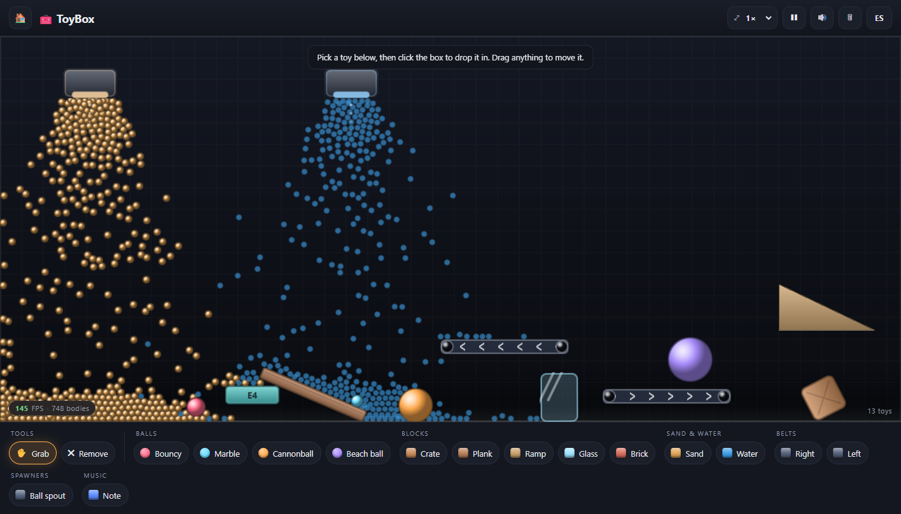

# ToyBox

A box of little physics toys. Drop in balls with different weight and bounce,
stack crates, shatter glass, ride conveyor belts, and knock out a tune on the
musical blocks. Drag anything, throw it, watch what happens. A ball spout keeps
filling the box on its own, and the playfield can be zoomed out up to 2.5× when
you want to fit more in.

It runs entirely in the browser — no server, no accounts, nothing stored, no
image or sound files (the audio is synthesised).



Live at **https://elnuevos.es/toybox**.

## Develop

```bash
npm install
npm run dev        # http://localhost:5175
```

## Check & build

```bash
npm run typecheck
npm run test       # vitest: physics, toy catalog, note maths, frame meter
npm run build      # outputs ./dist
```

## Performance

The frame rate is on screen (bottom-left), and `npm run bench` drives the built
app in a headless browser to measure the same thing without a human watching:

```bash
npm run build
npx vite preview --port 4173 &
npm run bench -- --url http://127.0.0.1:4173/ --sizes 0,500,1000,1500,2000
npm run bench -- --url http://127.0.0.1:4173/ --spawners 6 --seconds 80
npm run bench -- --url "http://127.0.0.1:4173/?render=2d" --sizes 0,2000
```

Roughly: **it holds 60 fps up to ~1350 bodies** in a 1416×672 box, and physics
is what costs. Drawing goes to the GPU as a handful of instanced draw calls
(`src/engine/gl/`), so the painter takes 0.06–0.5 ms whatever is in the box —
against 8.6–12.6 ms for the canvas 2D path at a few thousand bodies, which is
kept as the fallback (`?render=2d`). Six spouts take about a minute to fill the
box that far.

The numbers, the method and the caveats (headless has no vsync; `draw-ms` under
WebGL is CPU submission, not GPU work) are in
[`PERFORMANCE.md`](./PERFORMANCE.md).

For the next order of magnitude — what to cache, which corner of the simulation
to cut, and why "tens of thousands of rigid bodies at 60 Hz" is not a thing in
a browser — see the same file. It also covers the granular solver prototype in
[`src/physics/grains.ts`](./src/physics/grains.ts), which simulates circles
5–12× cheaper than the rigid-body engine and is the next thing to build on.

## Add a toy

Edit [`src/toys/catalog.ts`](./src/toys/catalog.ts) — a toy is a palette entry
plus a factory that builds its Matter.js body, with metadata for colour, belt
speed, break threshold or pitch. Add the name to both dictionaries in
[`src/i18n.ts`](./src/i18n.ts) and list it in a `PALETTE_GROUPS` group.

## Deploy

This is a **static** app: Caddy serves the built files under `/toybox`, exactly
like the root dashboard and `/jigsawpuzzle`. No Node process, no port, no pm2.

On the server, one time:

```bash
sudo mkdir -p /var/www/toybox
sudo chown -R "$USER":"$USER" /var/www/toybox
```

Then, from the repo root (never with `sudo` — the webhook runs it as the deploy
user):

```bash
bash deploy/setup.sh          # builds with BASE_PATH=/toybox, publishes to /var/www/toybox
```

Finally add the `handle_path /toybox*` block from
[`deploy/Caddyfile`](./deploy/Caddyfile) to the domain config in the ElNuevos
repo and `sudo systemctl reload caddy`. Auto-deploy: add the repo to
`ElNuevos/deploy/webhook/deploy.config.json` and point a GitHub webhook at
`https://elnuevos.es/_hooks/deploy`.

## How it fits the platform

`elnuevos.es` hosts independent apps, one per URL path. This one owns `/toybox`;
the prefix is baked into the build via `BASE_PATH` so its assets can't collide
with its neighbours. Design notes live in [`PLAN.md`](./PLAN.md).
